# Schema Editor: developer guide

Read this before changing the schema editor. The [app README](../README.md)
describes what authors can do. These pages explain how the editor works.

| Page | Read it when you |
|---|---|
| [spec.md](spec.md) | change what gets saved: the model, the JSON mapping, validation or storage |
| [recipes.md](recipes.md) | add an element, a setting, a lint rule, a panel view or an event |

## Mental model

Each open schema has one `SchemaStore` (`core/session/store.js`).

- The store does not hold JSON. It holds an **authoring model**: a tree of
  nodes with session ids.
- Views get the model from bus broadcasts.
- Views change the model only by dispatching pure **commands**.
- Every change is linted and can be undone. The model is saved as plain JSON
  Schema.



## Rules

1. **`core/` is pure.** It has no DOM, no network and no Lit, and it runs
   under `node --test`. Any rule that decides *what* an edit does belongs
   here: drop targets, insertion points, page membership and lint. The `ui/`
   layer only renders the result and passes the intent on.
2. **The store is the only gateway.** Views call `dispatch(command, args)`,
   `undo`, `redo`, `select`, `setMode` and `save`. They never assign
   `store.model` and never change a node in place.
3. **Commands are pure.** A command is `(model, args) → { model, label }` and
   reuses every subtree it does not touch.
   - Returning the same model means nothing changed, so nothing goes into
     history.
   - Throw `CommandError` to refuse an edit. The store shows its message as a
     toast.
4. **State goes out on the bus** (`core/session/bus.js`).
   - `*State` channels broadcast, and replay the last value to late
     subscribers such as lazily loaded panel views.
   - `*Request` channels carry one-off commands.
   - Lit views subscribe through `BusController`.
5. **I/O is injected.** The store receives `repository`, `validateSchema` and
   `bus`, and tests pass fakes. Only `adapters/` talk to DA, the SC SDK and the
   shell.
6. **The saved format is a contract.** The da.live form editor and content
   delivery read the same document. Saved keys are locked because renaming one
   would orphan existing content. See [spec.md](spec.md#storage).
7. **Issues have one source.**
   - `parseSchema` never throws and never reports problems. It records what it
     found.
   - `lint` turns those findings into issues.
   - The SC SDK is the final check on save.

## One edit, one save



**Edit.** When a command returns a new model:

1. The result goes into history. Typing in one field is merged into one undo
   step through `coalesceKey`.
2. The result becomes the current model.
3. The model is linted again and broadcast as `modelState`.

**Save.** Saving runs these checks in order:

1. Save is refused while lint reports errors.
2. The SC SDK checks the serialized JSON.
3. The schema is written only if that check passes.

Saves never overlap. A save requested during another one waits for it, then
runs if there are still unsaved changes.

## Working on it

```sh
node --test "test/tools/apps/schema-editor/**/*.test.js"
npx eslint tools/apps/schema-editor test/tools/apps/schema-editor
npx stylelint "tools/apps/schema-editor/**/*.css"
```

- **Tests** mirror the source tree in
  `test/tools/apps/schema-editor/{core,adapters,ui}`. New logic goes in `core/`
  with a test next to its peers.
- **SDK conformance**: `core/model/sdk-conformance.test.js` checks the editor
  against the real SC SDK (the pinned `@adobe/da-sc-sdk` devDependency) and the
  schema spec: exact output, value checks, imports, and seeded random editing.
  To move to a new SDK, bump the pin and run it.
- **To run the app**, start `aem up` and open it with `?ref=local&nxver=2`. See
  [Development](../README.md#development).
- **The diagrams** in `diagrams/` are SVGs drawn with
  [diagram-design](https://cathrynlavery.github.io/diagram-design/). When the
  architecture changes, update them in the same change.
