# Schema Editor: spec

What the editor reads, edits and writes. The Structured Content subset of JSON
Schema is defined in the SC SDK's
[schema spec](https://github.com/adobe/da-sc-sdk/blob/main/docs/schema-spec.md).
That spec is the source of truth for rules R1–R11, the supported keywords and
`x-semantic-type`. This page does not repeat it. It describes how the editor
maps that subset onto its own model.

## The round trip



| Step | Module | Guarantee |
|---|---|---|
| Read · unwrap | `adapters/schemas.js`, `core/codeblock.js` | Takes the JSON out of the document's single `<pre><code>`. Returns an error for anything that is not a JSON object. |
| Parse | `core/model/parse.js` | Never throws. Unknown keywords go to `extras` on their node. Nodes it can't model become `unsupported` and keep their `raw` JSON and a `reason`. |
| Serialize | `core/model/serialize.js` | Writes `extras` and `raw` back unchanged. Ids are dropped. Key order is stable, so `stringifySchema` can detect unsaved changes. |
| Wrap · save | `adapters/schemas.js` | Writes the same document shape it reads. |

A schema the editor does not fully understand still opens. It keeps the parts
it can't model, flags them, and saves them back untouched.

## Model

```js
{
  version: 1,
  name,                       // the file name
  root,                       // a Group or a List node (R11)
  defs: [{ id, name, node }], // components → $defs
  rootExtras: { $schema },    // $schema, $id, $vocabulary
}
```

### Nodes

- **Every node:**
  - `id` exists only for the session.
  - `kind` is one of `string`, `number`, `integer`, `boolean`, `object`,
    `array`, `ref` or `unsupported`.
  - Also: `title`, `description`, `default`, `readOnly`, `extras`.
- **Fields of a Group** also carry:
  - `key`, the property name.
  - `required`.
  - `keyLocked`, set once the key has been saved.
- **Kind-specific fields:**

  | Kind | Fields |
  |---|---|
  | `string` | `variant` |
  | `object` | `children` |
  | `array` | `item` |
  | `ref` | `refDefId` |
  | `unsupported` | `raw`, `reason` |

Elements are what authors pick. They are views over `kind` + `variant`, all
in one table, `ELEMENTS` in `core/model/elements.js`:

| Element | Node | JSON Schema |
|---|---|---|
| Text | `string` | `type: string` |
| Long text | `string`, `long-text` | `+ x-semantic-type: long-text` |
| Choice | `string`, `choice` | `+ enum` |
| Date, Time, Date & time | `string`, `date` / `time` / `date-time` | `+ format` |
| Number, Whole number | `number`, `integer` | `type`, `minimum`, `maximum` |
| Yes / No | `boolean` | `type: boolean` |
| Group | `object` with `children` | `properties`. `required[]` is built from the children's flags. |
| List | `array` with `item` | `items`, `minItems`, `maxItems` |
| Component use | `ref` with `refDefId` | `$ref: '#/$defs/<name>'`. Only `title` and `description` sit next to it. |

Text and Long text also take `minLength`, `maxLength` and `pattern`.
Changing an element keeps every setting that still applies. The store reports
the dropped settings in a toast.

### Components

A component is one entry in `$defs`. Components are referenced by `id` inside
the model and by name only in JSON, so renaming a component is a single edit.

- A component may use other components.
- A component can't contain itself, directly or through other components.
  The form editor can't render recursive schemas.
- Fields never move into or out of a component. Its fields are edited only on
  the Components page.

### Keys

- A key starts with a letter and uses letters, digits or `-` (R9).
- `metadata` and `section-metadata` are reserved (R10).
- A new field derives its key from its label.
- Once saved, the key is locked (`lockKeys`) and no longer follows the label.
  Renaming a saved key would orphan the content already stored under it, so
  the author must confirm before unlocking it.

## Validation

| Layer | When | Covers |
|---|---|---|
| `lint` (`core/model/lint.js`) | Every edit | SC rules, keys, defaults, choices, ranges, unsupported keywords, unused components, cycles, style hints |
| SC SDK `validateSchema` (`core/model/sdk.js`) | On save | The SDK's own verdict on the serialized JSON, mapped back onto nodes |

Every issue has the same shape:

```js
{ code, severity, message, nodeId, schemaPath, defId?, field?, fix? }
```

- `severity` is `error`, `warning` or `info`. Errors block saving.
- `field` points at the Properties control that shows the issue inline.
- `fix` is `{ label, run(model) }`, and it runs through `store.dispatch`, so
  a fix can be undone like any edit.
- SDK issues are cleared on the next edit and come back on the next save.

## Storage

```
/{org}/{site}/.da/forms/schemas/{name}.html
```

- One DA document per schema. The JSON sits, pretty-printed, in the
  document's single `<pre><code>` block.
- The da.live form editor and the GraphQL app read these same documents, so
  the path and the shape must not change.
- The file name is the schema's id: `[a-z0-9-]`, unique per site.

## Screens and pages

| Route | Screen |
|---|---|
| `#/{org}/{site}` | Browse: list, search, sort, create, duplicate, delete |
| `#/{org}/{site}/{name}` | Author |

The Author screen has two pages (`core/session/modes.js`):

- **Build** shows the schema's tree. Component uses appear as locked previews.
- **Components** shows one component at a time as an editable tree.

The page decides which nodes are shown and what can be selected. When a
selection is not shown on the current page, it moves to the nearest node that
is.

## Assistant

When the shell offers the DA chat:

- `core/session/chat.js` sends the schema, and any unsaved draft, as context.
- After each assistant turn it calls `store.refresh()`. That picks up the
  saved change as one undoable "assistant changes" step.
- An unsaved draft is replaced only if the assistant was given it.
